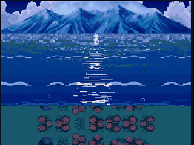
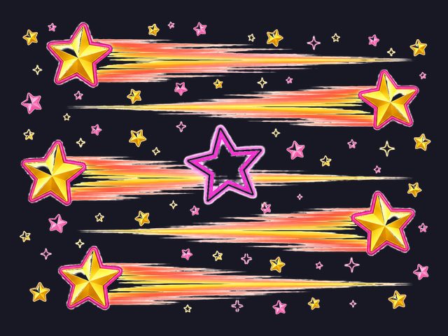
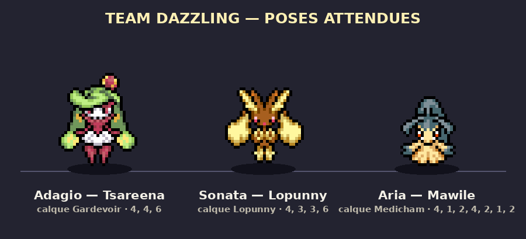

# Aperçus Dimensional Scream — Team Dazzling

Page HTML autonome : [previews_dimensional_pre_battle_dazzling.html](previews_dimensional_pre_battle_dazzling.html)

## Dimensional Scream

## Pre-Battle Team Dazzling — Cœurs

Overlay transparent, indépendant de toute map.

## Pre-Battle Team Dazzling — Étoiles

Overlay transparent, indépendant de toute map.

Image étoile générée puis détourée :

## Pose Team Dazzling

Page complète : [team_dazzling_pose.html](team_dazzling_pose.html)

Version ralentie : [team_dazzling_pose_face_ralenti.gif](team_dazzling_pose_face_ralenti.gif)

## Assets PMDO associés

- [Pre_Battle_Dazzling_Coeurs.dir](assets/Pre_Battle_Dazzling_Coeurs.dir)
- [Pre_Battle_Dazzling_Etoiles.dir](assets/Pre_Battle_Dazzling_Etoiles.dir)

Ces fichiers sont des aperçus/assets sources versionnés pour relecture. Ils ne sont pas encore branchés comme transition de combat dans le jeu.
