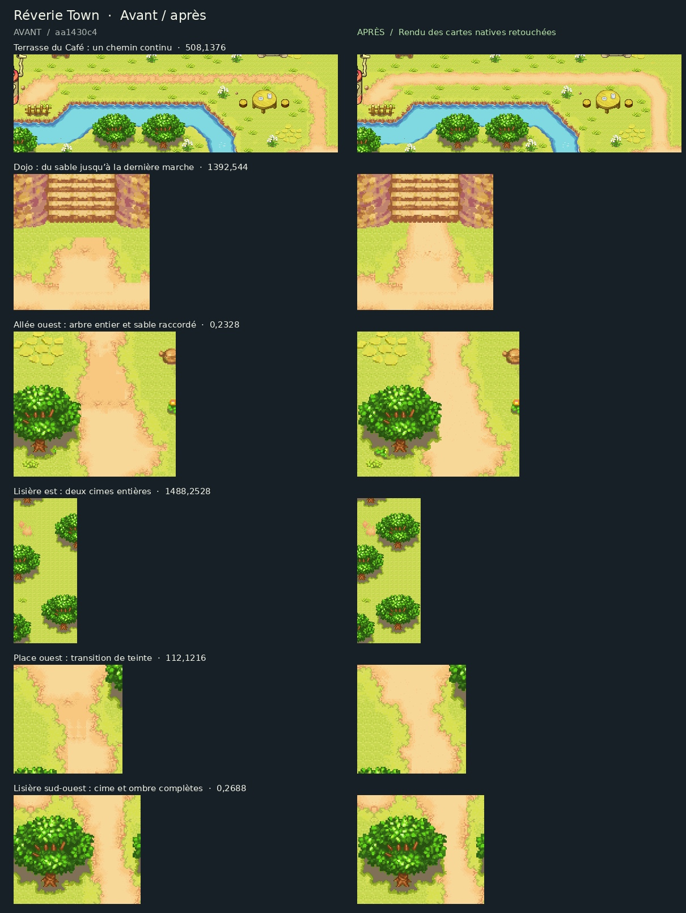
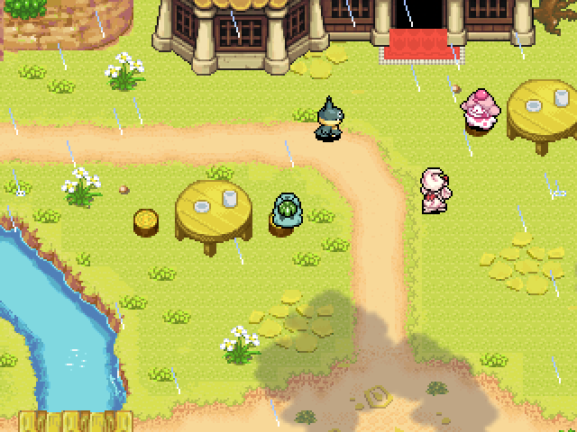

# Réverie Town — Bilan des retouches de la ville

La ville corrigée est incluse dans la [préversion v0.7.4](https://github.com/meromoonmeri/PMDO-Destiny/releases/tag/v0.7.4). Les dix cartes compressées de Réverie et la banque de tuiles retouchée sont identiques à celles intégrées par le [commit `d5d44d7`](https://github.com/meromoonmeri/PMDO-Destiny/commit/d5d44d7edbca8ad39406db10257df20fac845d40).

## Ce qui a été corrigé

| Endroit | Retouche |
| --- | --- |
| Terrasse du Café Spinda | Le chemin de sable reste continu le long de la terrasse et dans le virage vers le sud. |
| Escalier est du Dojo | Le sable rejoint la dernière marche au lieu de s’arrêter devant une bande d’herbe. |
| Allée et place ouest | Deux changements de teinte abrupts ont été adoucis, sans élargir les passages praticables. |
| Lisières est et ouest | Quatre arbres tronqués sont repris avec leur cime, leur tronc et leur ombre. |

L’herbe répétée a été raccordée à la texture voisine. Les cinq cartes — capitale, centre, nord, résidentiel et étang — et leurs copies d’édition ont reçu les mêmes retouches de calques. Les collisions, les seuils et les déclencheurs restent en place ; les rivières et cascades conservent leurs animations. La proposition plus large sur le vert foncé et les quatorze segments de chemin n’a pas été intégrée.

## Avant / après

À gauche, l’état avant les retouches (`aa1430c4`) ; à droite, le rendu des cartes natives corrigées. Il s’agit de détails du décor, pas d’une maquette.

## En jeu

Le chemin corrigé à la terrasse du Café Spinda, dans le centre de Réverie sous la pluie :

Les habitants peuvent échanger un regard ou une émote avec une réponse décalée. Les gestes ne prennent pas le dessus sur un dialogue, une scène ou un menu, et les commerçants ne quittent pas leur poste pour ces échanges. [Voir Lombre et Ludicolo en jeu](apercus/reverie-town/lombre-ludicolo.gif).

## Ce qui a été vérifié

- **Cartes :** les dix variantes concordent, la banque native se charge et les retouches restent dans les quatre secteurs prévus. Les données hors calques ont été conservées pour chaque carte. Les contrôles sont reproductibles avec [`test_polish_reverie.py`](../tools/tests/test_polish_reverie.py) et le [manifeste des retouches](../tools/reverie_polish_manifest.json).
- **PMDO 0.8.12 :** chargement du centre, passage près de la terrasse et réactions d’habitants observées en jeu. Ce sont des essais ciblés sur un profil local, pas une visite intégrale de tous les quartiers ni une validation audio.

Pour le détail des raccords et leur reconstruction, voir [la note technique du lot](POLISH_FOSSE_REVERIE.md). Les autres changements de la version, dont les étals de Zig et Zag, figurent dans [la note de mise à jour 0.7.4](REVERIE_074.md).
